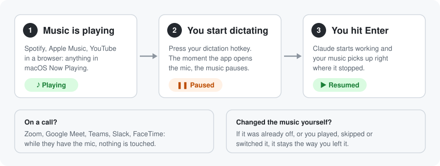
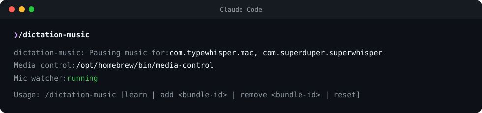

# dictation-music

Pauses your music when you start dictating a prompt, and brings it back once you hit Enter and Claude starts working.

<p align="center">
  
</p>

- **Any music app.** Spotify, Apple Music, Podcasts, YouTube or Spotify in a browser, VLC: anything that shows up in the macOS Now Playing control.
- **Any dictation app.** TypeWhisper and superwhisper work out of the box. Add yours with one command.
- **Leaves meetings alone.** While Zoom, Google Meet, Teams, Slack huddles, FaceTime, Webex or Discord is using your mic, it never pauses or resumes anything.
- **Only resumes what it paused.** If the music was already off, or you played, skipped or changed it yourself, it stays the way you left it.
- **Doesn't touch your prompts.** Nothing is added to your prompt, the system prompt or the context window. It only presses pause and play.

## Requirements

- macOS 14.2 or later
- Xcode Command Line Tools (`xcode-select --install`): the mic watcher is a small Swift program built on first run
- [media-control](https://github.com/ungive/media-control), which pauses and plays whatever is in Now Playing:

  ```bash
  brew install media-control
  ```

- A Claude Code build that supports mods (function-hook plugins), in the terminal or the desktop app's Code tab

## Install

Clone the repository once:

```bash
git clone https://github.com/yash-coded/claude-code-mods ~/.claude/claude-code-mods
```

Then add the mod to `~/.claude/settings.json`:

```json
{
  "env": {
    "CLAUDE_CODE_PLUGIN_DIRS": "~/.claude/claude-code-mods/mods/dictation-music"
  }
}
```

Start a new session (in the desktop app, quit and reopen it once), then run `/dictation-music` to check that everything was found:

<p align="center">
  
</p>

## Add your dictation app

Run this in any session, then start dictating:

```
/dictation-music learn
```

The next app that uses your microphone is added. Or add one by bundle ID:

```
/dictation-music add com.example.yourapp
```

To find an app's bundle ID:

```bash
osascript -e 'id of app "Wispr Flow"'
```

| Command | What it does |
| --- | --- |
| `/dictation-music` | Show which apps pause your music, and whether media-control and the mic watcher are working |
| `/dictation-music learn` | Add the next app that uses the mic |
| `/dictation-music add <bundle-id>` | Add an app |
| `/dictation-music remove <bundle-id>` | Stop an app from pausing music |
| `/dictation-music reset` | Back to the defaults |

The list lives in `~/.claude/dictation-music/config.json` if you'd rather edit it by hand.

Meeting apps and browsers can't be added: browsers are where Google Meet and other web calls run, so treating them as dictation would pause your music on every call.

## How it works

1. When a session starts, a small Swift helper watches which apps are using the microphone through Core Audio. It never records or reads audio: it only checks *whether* each app has the mic open.
2. When one of your dictation apps opens the mic and no meeting app has it, the mod asks Now Playing what's on. If something is playing, it pauses it and notes the track and position.
3. When you submit a prompt, the mod presses play again, but only if:
   - the same track is still paused at the same spot (you haven't taken over),
   - no meeting has started since, and
   - the pause is less than 15 minutes old.

**Sending a message while Claude is already working.** Claude Code holds that message until Claude reaches its next step, so the music comes back when Claude picks the message up rather than the moment you press send. It never comes back while your dictation app still has the mic.

**Dictating somewhere else.** If you dictate into another app and never submit to Claude, the music stays paused. Start dictating again within 2 minutes and the next submit still brings it back. After that, the mod treats the silence as your choice and forgets its pause.

## Troubleshooting

Run `/dictation-music` first: it reports what's missing.

- **"Media control: not found"**: run `brew install media-control`.
- **"Mic watcher: build failed"**: install the Xcode Command Line Tools with `xcode-select --install`, then start a new session.
- **Music doesn't pause**: check that your dictation app is in the list, or run `/dictation-music learn` and dictate once.
- **Music pauses but doesn't come back**: you may have changed the track or position while it was paused, or a call may have the mic.
- **Music comes back too early**: your dictation app may pause media itself (TypeWhisper calls this "Pause media playback during recording"). Turn that off so the two don't fight.

## Files

```
hooks/register.ts             the mod: what pauses, when it resumes, the /dictation-music command
helper/dictation-watch.swift  prints "start <app>" / "stop <app>" as apps open and close the mic
tests/                        tests against a fake machine (files, mic and player)
assets/                       the images in this README
```

Changed the Swift helper? Bump `HELPER` in `hooks/register.ts` so existing installs rebuild it. See the [repository README](../../README.md#developing-a-mod) for validating, testing and type-checking.

## Uninstall

Remove this mod's path from `CLAUDE_CODE_PLUGIN_DIRS` in `~/.claude/settings.json`, then delete `~/.claude/dictation-music`.

## Credits

Now Playing control by [media-control](https://github.com/ungive/media-control) by Jonas van den Berg.
